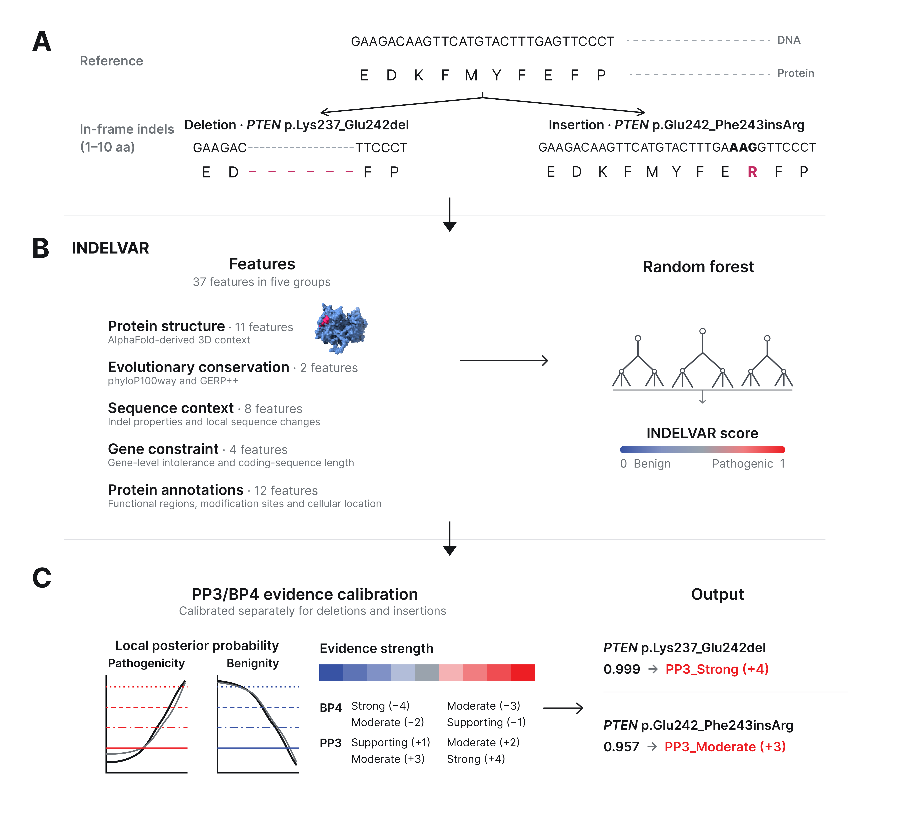

# INDELVAR



## Overview

INDELVAR predicts the pathogenicity of in-frame insertions and deletions spanning 1–10 amino acids in MANE Select coding sequences. Given a GRCh38 variant, it returns 37 model features, an INDELVAR score, and its calibrated ACMG/AMP computational evidence strength.

## Installation

```bash
python -m pip install git+https://github.com/eunhui-ji/INDELVAR.git@v2.0.0
```

To score variants directly:

```bash
git clone --branch v2.0.0 https://github.com/eunhui-ji/INDELVAR.git
cd INDELVAR
python -m pip install ".[direct]"
```

Direct scoring requires R with `randomForest` and `digest`, Docker, and the reference datasets listed by `indelvar setup --check`.

## Usage

```bash
indelvar setup --check
indelvar cutoffs
indelvar score --variant 10:100827584:C:CCTGCCGCTG --output -
```

Input variants can be provided as `CHROM POS REF ALT` coordinates or as VCF, TSV, or CSV files. A VCF must be GRCh38 with normalized REF/ALT; in-frame coding deletions and insertions of 1–10 amino acids are scored.

```bash
indelvar score --input variants.vcf --output scored.tsv --mode lookup
indelvar score --input variants.tsv --output scored.tsv --mode auto
indelvar score --input variants.tsv --output scored.tsv --mode direct
```

| Mode | Action |
|---|---|
| `lookup` | Retrieve a score from the downloaded database. |
| `auto` | Use the database when available and calculate other supported variants. |
| `direct` | Calculate scores without database lookup. |

Each output row carries variant and transcript identifiers, the 37 model features, the INDELVAR score, its PP3/BP4 computational evidence, and provenance fields.

| Column | Description |
|---|---|
| `indelvar_score` | INDELVAR score from 0 to 1 |
| `computational_evidence` | Calibrated PP3/BP4 evidence strength; not a clinical classification |
| `computational_evidence_points` | Signed PP3/BP4 evidence points |
| `n_features_imputed`, `imputed_features` | Number and names of imputed features |

## Precomputed database

Precomputed scores for 372,518 variant-transcript rows from ClinVar, IGSR, and dbSNP are available from [Zenodo](https://doi.org/10.5281/zenodo.21285600).

| File | Description |
|---|---|
| `indelvar_precomputed.sqlite` | Database used by the INDELVAR CLI for fast lookup |
| `indelvar_precomputed.tsv.gz` | The same records as a compressed table, for bulk analysis |

```bash
export INDELVAR_DB=$PWD/indelvar_precomputed.sqlite
```

## Datasets

Training, independent test, VUS, and calibration reference datasets are available in [`dataset/`](dataset/). Model files and calibration cutoffs are available in [`model/`](model/).
